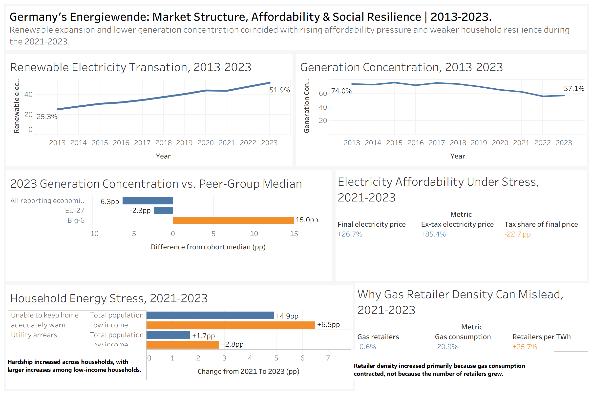

# Germany’s Energiewende: Market Structure, Affordability & Social Resilience (2013–2023)

[](.github/workflows/ci.yml)
[](data/manifest.json)
[](LICENSE)

**Decision-focused empirical analysis of how Germany’s decade of renewable-electricity expansion relates descriptively to generation market concentration, gas-retail structure, household energy affordability, and social resilience across 36 European economies (2013–2023).**

---

## Executive Summary

Germany substantially expanded renewable electricity (`25.3% → 51.9%`, `+26.7 pp`) and reduced electricity-generation concentration (`74.0% → 57.1%`, `-16.9 pp`) between 2013 and 2023, but the 2021–2023 stress period exposed higher household electricity costs (`+26.7%`) and weakening social resilience—with larger hardship increases among low-income households. The analysis also shows that Germany’s apparent competitive position depends strongly on the selected European peer group (`#21 of 35` broadly vs. `#2 of 6` among large markets) and that a favorable-looking increase in gas-retailer density (`+25.7%`) was driven primarily by falling gas consumption (`-20.9%`) rather than retailer entry (`-0.6%`).

*All findings are descriptive and benchmark-sensitive; co-movement does not establish causality.*

---

## Executive Dashboard (Tableau)



> *Results are descriptive and benchmark-sensitive. Co-movement does not establish causality; peer-group definitions materially affect concentration comparisons.*  
> *Scope: 36 European economies, 2013–2023 | Upstream ETL: Python | Profiling: R | Analytical Layer: MySQL | Executive Dashboard: Tableau*  
> *(A supplementary interactive web explorer is also published via GitHub Pages from [`docs/index.html`](https://monaim-knight.github.io/germany-energiewende-market-social-impact/).)*

---

## Decision Context & Policy Problem

Energy-policy teams, market regulators (e.g., Bundesnetzagentur / ACER), and utility strategists routinely monitor headline transition KPIs—renewable share, market concentration, retailer counts, tax wedges, and household hardship—in separate silos. Relying on unexamined ratios or poorly matched peer cohorts leads to flawed conclusions:

- Comparing Germany against small island or non-EU single-utility markets makes its generation sector appear relatively unconcentrated.
- Tracking `gas retailers per TWh` during a demand shock mistakes contracting gas consumption for competitive market entry.
- Observing a lower electricity tax share without inspecting the ex-tax component obscures why household bills still surged.

---

## Five Analytical Questions & Verified Findings

All headline metrics are computed in MySQL ([`sql/06_analytical_queries.sql`](sql/06_analytical_queries.sql)), exposed via five Tableau views ([`sql/07_tableau_views.sql`](sql/07_tableau_views.sql)), and independently verified by automated tests ([`tests/test_pipeline.py`](tests/test_pipeline.py)):

### 1. Germany’s Transition (2013–2023)
*How did Germany’s renewable electricity, generation concentration, household electricity price, and thermal hardship evolve?*
- **2013 → 2019 (pre-crisis):** Renewable electricity rose **`+15.320 pp`** (`25.284% → 40.604%`), concentration edged down **`-3.900 pp`** (`74.000% → 70.100%`), electricity prices remained nearly flat (**`+2.16%`**, `€0.292000 → €0.298300/kWh`), and inability to keep homes warm improved (**`-2.800 pp`**, `5.300% → 2.500%`).
- **2019 → 2023 (stress period):** Renewables rose another **`+11.341 pp`** (to `51.945%`) and concentration fell **`-13.000 pp`** (to `57.100%`), while electricity prices jumped **`+36.52%`** (to `€0.407250/kWh`) and thermal hardship worsened **`+5.700 pp`** (to `8.200%`).
- **Full decade (2013–2023):** Renewables **`+26.661 pp`**, concentration **`-16.900 pp`**, electricity price **`+39.47%`**, thermal hardship **`+2.900 pp`**.

### 2. Concentration Benchmark Sensitivity (2023)
*Is Germany’s 2023 electricity-generation concentration (`57.100%`) high or low relative to European peers?*

| 2023 Peer Cohort | Reporting Economies | Cohort Median | Germany Rank | Germany vs. Median | Decision Context Supported |
|---|---:|---:|---:|---:|---|
| **All reporting economies** | 35 | `63.355%` | `21 of 35` | **`-6.255 pp`** | Broad pan-European coverage (includes micro-markets) |
| **EU-27 (2023 cross-section)** | 27 | `59.440%` | `15 of 27` | **`-2.340 pp`** | EU regulatory membership *(balanced 2013–2023 EU-27 N=26 median is `59.570%`, `-2.470 pp`)* |
| **Big-6 large markets** (`FR, DE, ES, PL, IT, NL`) | 6 | `42.145%` | **`2 of 6`** | **`+14.955 pp`** | Size-comparable interconnected markets (behind only France at `78.940%`) |

### 3. Gas-Retailer-Density Denominator Effect (2021–2023)
*Did Germany’s rising `retailers per TWh` reflect retailer entry or declining gas consumption?*
- **Gas retailers (numerator):** `979 → 973` (**`-0.61%`**)
- **Final gas consumption (denominator):** `698.194 → 552.198 TWh` (**`-20.91%`**)
- **Retailers per TWh (ratio):** `1.402188 → 1.762048` (**`+25.66%`**)
- **Implication:** The `+25.66%` density increase was primarily **denominator-driven**—not evidence of retailer entry or stronger competition.

### 4. Electricity-Price Decomposition (2021–2023)
*Why did Germany’s household electricity price rise while the tax share fell?*
- **Final price (all taxes):** `€0.321350 → €0.407250/kWh` (**`+26.73%`**)
- **Ex-tax component (`X_TAX`):** `€0.157900 → €0.292750/kWh` (**`+85.40%`**)
- **Tax share of final price:** `50.864% → 28.115%` (**`-22.749 pp`**)
- **Implication:** A sharply lower tax share did not reduce final bills because the combined ex-tax component grew much more strongly. *(This dataset does not split the ex-tax component into wholesale, network, or margin drivers.)*

### 5. Social-Resilience Stress Test (2021–2023)
*Did household energy stress worsen more for low-income households (`<60%` median income) than for the total population?*
- **Unable to keep home warm:** Total population `3.3% → 8.2%` (**`+4.9 pp`**); low-income `7.8% → 14.3%` (**`+6.5 pp`**). Direct low-income vs. total gap widened from `4.5 pp` to `6.1 pp` (**`+1.6 pp`**).
- **Utility bill arrears:** Total population `3.7% → 5.4%` (**`+1.7 pp`**); low-income `6.5% → 9.3%` (**`+2.8 pp`**). Direct low-income vs. total gap widened from `2.8 pp` to `3.9 pp` (**`+1.1 pp`**).
- **Metric audit catch:** Stored `unable_warm_income_gap_pp` and `utility_arrears_income_gap_pp` compare `<60%` vs. `≥60%` income groups (`B_60 − A_60`), not `<60%` vs. `TOTAL`. Query 5 therefore computes direct `low-income − total` gaps from the component columns to match the policy question.

---

## Why This Analysis Matters

For German energy-policy and BI teams, three operational lessons stand out:
1. **Never report a concentration rank without stating the peer cohort** (`#21/35` vs. `#2/6` implies completely different competitive priorities).
2. **Always decompose ratio KPIs during macro shocks** before interpreting upward ratio movement as market health.
3. **Track distributional household stress separately from market structure:** structural progress in renewables and concentration coincided with widening low-income thermal hardship during 2021–2023.

---

## Data, Scope & End-to-End Architecture

- **Scope:** `36` European economies, `2013–2023` (`396` rows × `47` columns, balanced country-year panel, composite primary key `(geo, year)`), assembled from **8 official Eurostat datasets** (`nrg_ind_market`, `nrg_bal_s`, `demo_pjan`, `nrg_ind_ren`, `nrg_pc_204`, `nrg_pc_202`, `ilc_mdes01`, `ilc_mdes07`). Full lineage and SHA-256 hashes are in [`data/manifest.json`](data/manifest.json) and [`docs/data_provenance.md`](docs/data_provenance.md).

```text
Eurostat API (8 tables)
  └─► Python ETL (src/energiewende/) ──► data/processed/master_panel.csv (396 x 47) + SHA-256 manifest
        └─► R Profiling & Validation (R/01_profile_and_validate_master_panel.R)
              └─► MySQL Staging (master_panel_staging, all TEXT)
                    └─► Controlled Transformation (0 warnings) ──► germany_energiewende.master_panel
                          └─► 5 Analytical Queries (sql/06) + 5 Tableau Views (sql/07)
                                └─► Single Executive Tableau Dashboard (assets/energiewende_executive_dashboard.png)
```

---

## Data-Quality & Ingestion Decisions

- **Risk-driven R profiling ([`R/01_profile_and_validate_master_panel.R`](R/01_profile_and_validate_master_panel.R)):** Verified `396` unique `(geo, year)` keys, 11-year balance, bidirectional `geo ↔ country_name` mapping, stable cohort flags, 7 whole-number fields, 4 fields with legitimate negative values (including crisis energy-subsidy tax shares), and `ren_elec_pct > 100%` in net hydro exporters (preventing an erroneous `0–100` constraint).
- **Why MySQL staging was necessary ([`docs/validation.md`](docs/validation.md)):** Direct CSV import into typed `master_panel` inserted `396` rows with thousands of warnings—coercing blanks to `0.000`, mis-casting `True/False` text to `0`, and failing on decimal-formatted counts like `"4.0"`. That load was rejected and replaced by an all-`TEXT` staging table (`sql/02`) plus an explicit transactional transformation (`sql/04`) using `TRIM()`, `NULLIF(..., '')`, `CASE` Boolean mapping, and two-stage integer casting (`TEXT → DECIMAL(20,6) → UNSIGNED`), achieving **`396` rows, `0` duplicates, `0` warnings**.

---

## Analytical Methodology & Tableau Dashboard Design

- **Methodology ([`docs/methodology.md`](docs/methodology.md)):** Uses cohort medians to resist small-market skew, anchors stress tests on `2021–2023` (avoiding Germany’s 2020 EU-SILC break), decomposes ratios explicitly, and separates ETL, validation, relational analytics, and presentation cleanly.
- **Tableau design ([`tableau/README.md`](tableau/README.md)):** Intentionally constrained to **one fixed-layout executive dashboard** sourced directly from the five validated MySQL views (`vw_tableau_*`)—no duplicated median/rank calculations in Tableau and no unnecessary secondary dashboards. Blue encodes structural trends/broad comparisons/total population; orange signals attention items/Big-6 exception/low-income vulnerability/denominator caution.

---

## Reproducibility

### 1. Python Upstream ETL & Automated Contract Tests
```bash
python -m venv .venv
source .venv/bin/activate   # Windows: .venv\Scripts\activate
pip install -e ".[dev]"
python -m energiewende.pipeline
pytest -v
```

### 2. R Panel Profiling & Validation (from repo root)
```bash
Rscript R/01_profile_and_validate_master_panel.R
```

### 3. MySQL Analytical Layer & Tableau Views (MySQL 8.0+)
Run scripts in order (`sql/00` → `sql/07`):
1. `sql/00_create_database.sql` — create `germany_energiewende`
2. `sql/01_create_master_panel.sql` — create typed 47-column table with `PRIMARY KEY (geo, year)`
3. `sql/02_create_staging_table.sql` — create all-`TEXT` `master_panel_staging`
4. `sql/03_load_staging_template.sql` — replace `<PATH_TO_REPO>` with your local path and load CSV (see `local_infile` security note inside the file; keep strict SQL mode enabled)
5. `sql/04_transform_staging_to_master.sql` — execute transactional staging→final load (`396` rows, `0` warnings)
6. `sql/05_reconciliation_checks.sql` — verify row counts, NULL preservation, and Boolean/decimal fidelity
7. `sql/06_analytical_queries.sql` — run all five analytical queries
8. `sql/07_tableau_views.sql` — create the five `vw_tableau_*` presentation views

---

## Repository Structure

```text
├── README.md                           # Decision-oriented project overview
├── LICENSE                             # MIT License + Eurostat attribution notice
├── EXECUTIVE_DECISION_BRIEF.md         # 2-page policy & stakeholder memo
├── METHODOLOGICAL_AUDIT_LOG.md         # Historical v1 -> v2 -> v3 error-remediation audit
├── CODEBOOK.md                         # Summary Eurostat indicator reference
├── assets/
│   └── energiewende_executive_dashboard.png  # Exported Tableau executive dashboard
├── data/
│   ├── README.md                       # Data directory & Eurostat reuse guide
│   ├── raw/                            # Original Eurostat nrg_ind_market TSV
│   ├── external/                       # 7 cached Eurostat API extracts
│   ├── processed/master_panel.csv      # Validated 396 x 47 analytical panel
│   └── manifest.json                   # SHA-256 provenance & API query log
├── R/
│   └── 01_profile_and_validate_master_panel.R  # Risk-driven grain & datatype profiling
├── sql/
│   ├── 00_create_database.sql          # Database creation
│   ├── 01_create_master_panel.sql      # Typed analytical table DDL
│   ├── 02_create_staging_table.sql     # All-TEXT staging DDL
│   ├── 03_load_staging_template.sql    # Portable LOAD DATA template
│   ├── 04_transform_staging_to_master.sql  # Controlled casting & transformation
│   ├── 05_reconciliation_checks.sql    # Row & semantic reconciliations
│   ├── 06_analytical_queries.sql       # Five completed analytical queries
│   └── 07_tableau_views.sql            # Five Tableau presentation views
├── tableau/
│   └── README.md                       # Tableau architecture & view connection guide
├── docs/
│   ├── data_dictionary.md              # Full 47-column dictionary
│   ├── data_provenance.md              # Eurostat sources, dates & lineage
│   ├── validation.md                   # R & MySQL ingestion validation evidence
│   ├── methodology.md                  # Analytical design & cohort rules
│   ├── limitations.md                  # Scope, measurement & non-causal limits
│   ├── responsible_ai.md               # Factual AI-assistance disclosure
│   └── index.html                      # Supplementary GitHub Pages web explorer
├── src/energiewende/                   # Modular Python Eurostat ETL & reporting package
├── tests/test_pipeline.py              # Automated data-contract & SQL-alignment tests
├── outputs/                            # Supplementary CSV tables & Matplotlib figures
└── paper/                              # Reproducible LaTeX manuscript (main.pdf)
```

---

## Limitations & Responsible AI Use

- **Limitations ([`docs/limitations.md`](docs/limitations.md)):** Descriptive/non-causal scope; peer-cohort benchmark sensitivity; voluntary Eurostat reporting gaps; legitimate negative tax shares under crisis subsidies; unsplit ex-tax electricity component; concentration/density do not measure market conduct; stored `income_gap_pp` (`B_60 − A_60`) differs from `low-income − total`; Germany 2020 EU-SILC break; static 2013–2023 window.
- **Responsible AI ([`docs/responsible_ai.md`](docs/responsible_ai.md)):** AI assisted with Python ETL scaffolding, script cleanup, and documentation drafting. Problem framing, R profiling, MySQL staging remediation, all five SQL queries/views, Tableau dashboard design, and verification against SQL outputs were owned and validated independently.

---

## Tools & Analytical Responsibilities

- **Python (`pandas`, `statsmodels`, `pytest`):** Upstream Eurostat API ingestion, SHA-256 provenance logging, automated contract testing, and supplementary reporting.
- **R (`readr`, `dplyr`, `stringr`, `purrr`):** Independent grain, identifier, cohort-stability, and datatype profiling prior to relational modeling.
- **MySQL 8.0+:** Controlled `TEXT` staging, typed composite-key storage, reconciliation checks, five analytical SQL queries, and five presentation views.
- **Tableau:** Single executive decision dashboard consuming validated MySQL views.

**Author:** Islam Md Monaim — [GitHub](https://github.com/Monaim-knight/germany-energiewende-market-social-impact)
