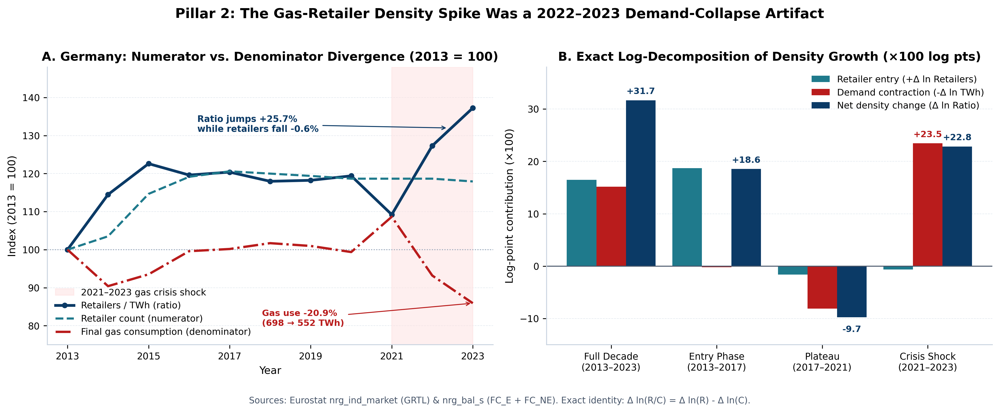
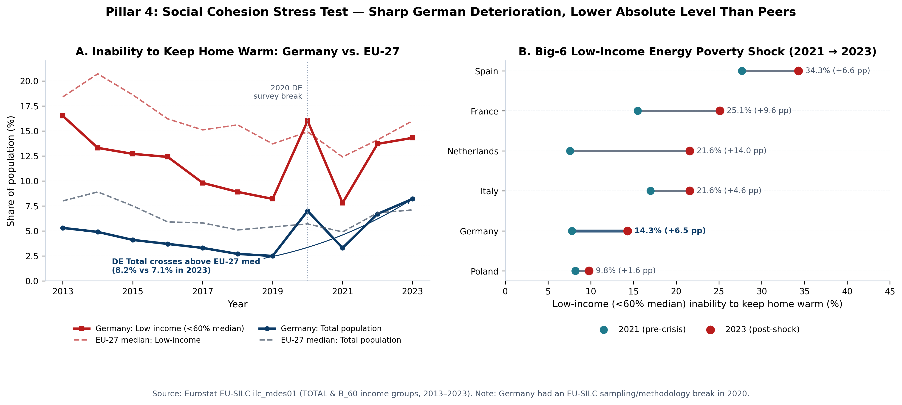

# Germany's Energiewende: Market Structure, Affordability & Social Resilience (2013–2023)

[](#reproduce)
[](data/manifest.json)
[](docs/index.html)

An end-to-end, reproducible European energy-policy analytics suite evaluating how Germany's decade of renewable buildout (`25.3% → 51.9%` renewable electricity) reshaped electricity and gas market concentration, household energy affordability, and social cohesion (`EU-SILC` thermal energy poverty) across **36 European economies (2013–2023)**.

> **Start here for decision-makers:** Read the 2-page [Executive Decision Brief](EXECUTIVE_DECISION_BRIEF.md), open the zero-backend [Interactive Executive Dashboard](docs/index.html) (GitHub Pages ready), or inspect the [AI-Era Methodological Audit Log](METHODOLOGICAL_AUDIT_LOG.md).

---

## Key Empirical Findings

1. **Peer-Cohort Sensitivity Reverses Germany's Power Concentration Rank:** Germany cut cumulative electricity generation concentration (`CMPY_EG5`) by **-16.9 pp** (`74.0% → 57.1%`). Against all 35 unbalanced reporters, Germany looks below median (`-6.3 pp`). Against a **balanced EU-27 cohort (`N=26`)**, it sits near the median (`59.6%`). Against **Europe's Big-6 large markets** (`DE, FR, IT, ES, PL, NL`), Germany is **`+15.0 pp` ABOVE the median (`42.1%`) — Rank #2 of 6**, behind only France (`78.9%`).
2. **Exact Log-Decomposition Exposes a 2022–2023 Gas Density Illusion:** Germany's `retailers/TWh` jumped **+25.7%** (`1.40 → 1.76`) between 2021 and 2023 while actual retailer count **fell -0.6%** (`979 → 973`). Exactly **102.7%** of the crisis log spike came from Germany's **-20.9% gas-demand collapse** (`698 → 552 TWh`). The cleaner concentration series (`GRTL_NG5`) confirms genuine structural fragmentation: major gas retailers (`≥5%` share) dropped from `26.0%` to **`13.3%`** (lowest in the Big-6 vs. `70.1%` median).
3. **Tax-Wedge Shift vs. Ex-Tax Price Surge:** Abolishing the EEG levy nearly halved Germany's electricity tax share (`50.9% → 28.1%`), yet ex-tax energy/network costs surged **+85.4%** (`€0.158 → €0.293/kWh`), pushing household electricity to **`€0.407/kWh`** (`0.364 PPS/kWh`)—highest nominal price in the Big-6.
4. **Social Cohesion Stress Test & Strict LOO Econometrics:** Germany's inability to keep homes warm (`ilc_mdes01`) more than doubled (`3.3% → 8.2%`, crossing **above** the EU-27 median of `7.1%`), reaching **`14.3%`** among low-income households (`<60%` median)—though still below Spain (`34.3%`), France (`25.1%`), Italy (`21.6%`), and the Netherlands (`21.6%`). Under a strict **100% leave-one-out + 95% CI gate**, within-country renewable growth strongly tracks power deconcentration (`-0.533 pp`, `34/34` LOO) and lower concentration tracks modestly lower PPS electricity prices (`27/27` LOO), whereas direct market-to-poverty links fail the gate—confirming that targeted fiscal/welfare buffers mediate social outcomes.




---

## Repository Architecture

```text
├── EXECUTIVE_DECISION_BRIEF.md   # 2-page boardroom/ministry stakeholder memo
├── METHODOLOGICAL_AUDIT_LOG.md   # Governance log: v1 error audit -> v2 reset -> v3 Track A
├── CODEBOOK.md                   # Authoritative variable dictionary across all 8 Eurostat tables
├── data/
│   ├── raw/                      # Original Eurostat nrg_ind_market TSV extract
│   ├── external/                 # Cached Eurostat API CSVs (7 supplementary tables)
│   ├── processed/master_panel.csv# Validated 396-row x 47-column integrated panel
│   └── manifest.json             # Cryptographic SHA-256 provenance & API query log
├── src/energiewende/             # Modular Python package (eurostat, ingestion, analytics, visuals, reporting, dashboard, pipeline)
├── tests/test_pipeline.py        # Automated data-contract, log-identity, cohort & LOO tests
├── outputs/
│   ├── RESULTS.md                # Auto-generated quantitative summary
│   ├── tables/                   # 20 machine-readable CSV exhibits
│   └── figures/                  # 5 publication-grade 300-DPI PNG + SVG figures
├── paper/
│   ├── main.tex                  # LaTeX manuscript (zero hardcoded drift via generated_macros.tex)
│   ├── generated_macros.tex      # Auto-generated numeric macros
│   ├── tables/                   # Auto-generated booktabs LaTeX tables
│   └── references.bib            # Verified Eurostat & EEA bibliography
├── docs/index.html               # Self-contained Interactive Executive Dashboard (GitHub Pages ready)
└── .github/workflows/ci.yml      # Automated CI: ruff lint + pipeline repro + pytest contracts
```

---

## Reproduce

```bash
python -m venv .venv
source .venv/bin/activate   # Windows: .venv\Scripts\activate
pip install -e ".[dev]"

# Reproduce full panel, tables, figures, LaTeX macros & dashboard (uses cached Eurostat files)
python -m energiewende.pipeline

# Optional: refresh all supplementary tables directly from the live Eurostat API
python -m energiewende.pipeline --refresh

# Run automated data contracts & analytical integrity tests
pytest -v
```

To publish the interactive dashboard on GitHub, enable **Settings → Pages → Deploy from branch (`main`, `/docs`)**.
